# SearchApp

App Android de búsqueda de música con pantalla de detalle, hecha con Jetpack Compose.

## API

[iTunes Search API](https://itunes.apple.com/search?term=jack&media=music): pública y sin API key.
Se consulta `GET /search?term=…&media=music&entity=song&limit=50`.

## Cómo ejecutar

1. Abrir el proyecto en Android Studio y ejecutar la configuración `app` en un emulador o dispositivo (minSdk 26), o bien:
   ```
   ./gradlew installDebug
   ```
2. Tests unitarios: `./gradlew :app:testDebugUnitTest`

## Arquitectura

Un solo módulo con tres capas separadas por paquetes, con dependencias en un único sentido
`presentation → domain ← data`:

- `domain`: `Track`, la interfaz `SearchRepository` y los casos de uso. Kotlin puro, sin Android ni Retrofit.
- `data`: Retrofit/OkHttp + kotlinx.serialization (`remote`), caché (`cache`) e implementación del repositorio.
- `presentation`: pantallas Compose, ViewModels con `StateFlow` y Navigation Compose.
- `di/AppContainer`: inyección manual (sin Hilt), creada una vez en `SearchApp`.

## Decisiones

**Caché.** `InMemoryTtlCache` guarda el resultado por query normalizada (`trim` + minúsculas) con TTL de 3 minutos.
Con una entrada válida no hay llamada de red; si expiró, se llama a la red y se reemplaza la entrada.
Los errores de red no se cachean. El reloj es una interfaz (`Clock`) inyectable y monotónico, por lo que la expiración se testea sin esperas.
El detalle resuelve la canción por id a partir de los resultados ya descargados (sin llamada extra), aunque la query ya haya expirado.

**Cancelación.** El `SearchViewModel` mantiene un único `Job` de búsqueda: cada cambio de texto lo cancela, pasa a *Cargando* de inmediato (así nunca se ven resultados de la búsqueda anterior junto al texto nuevo) y lanza otro tras un debounce de 400 ms
(la acción *Buscar* del teclado lo salta). Una respuesta de una búsqueda cancelada no puede llegar a la UI.
Las `CancellationException` nunca se capturan sin relanzarlas.

**Accesibilidad.**
- `contentDescription` en la carátula del detalle y `null` en las imágenes e iconos decorativos.
- Áreas táctiles de al menos 48 dp, textos en `sp` y layouts sin alturas fijas para texto (verificado con fuente al 200 %, ver [capturas](#3-tamaño-de-fuente-ampliado)).
- Colores del tema Material 3 por defecto (contraste de texto ≥ 4,5:1) y el error se comunica con texto e icono, no solo con color.
- Títulos con `heading()`; cada fila de la lista y cada campo del detalle se agrupan como un único elemento.
- Los estados de carga, vacío y error se anuncian con `liveRegion`.
- Campo de búsqueda con `label` visible e `ImeAction.Search`; todos los textos en `strings.xml`.

## Capturas

Evidencias tomadas en un dispositivo físico (Xiaomi 23113RKC6G, Android 16, en español) con la app real y la API real de iTunes.

1. [Búsqueda correcta](#1-búsqueda-correcta)
2. [Mensajes de vacío y de error](#2-mensajes-de-vacío-y-de-error)
3. [Tamaño de fuente ampliado](#3-tamaño-de-fuente-ampliado)
4. [Contraste y tema oscuro](#4-contraste-y-tema-oscuro)
5. [TalkBack](#5-talkback)

### 1. Búsqueda correcta

| Captura 1 | Captura 2 | Captura 3 |
|---|---|---|
| 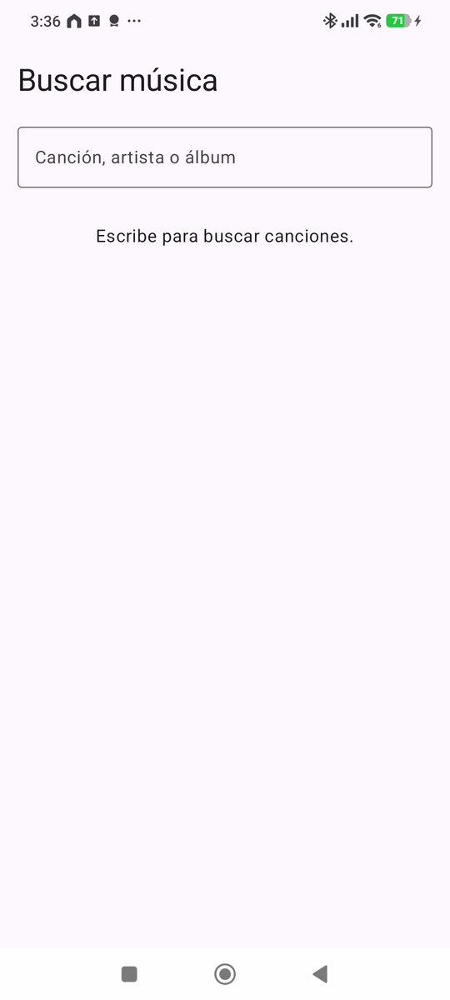 | 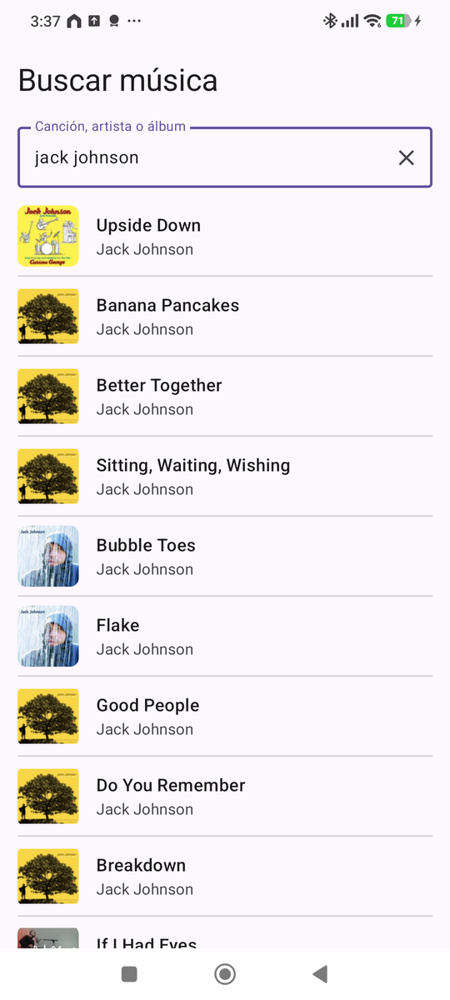 | 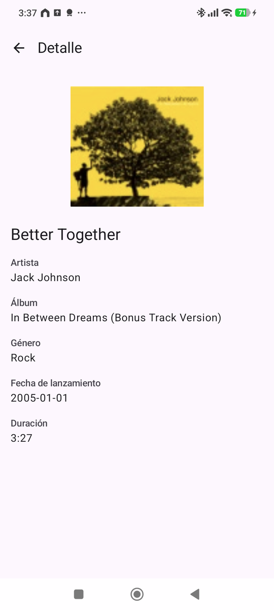 |
| **Estado inicial.** Título, campo con etiqueta visible y mensaje de ayuda. | **Resultados.** Cada fila muestra carátula, título y artista. El botón ✕ borra la búsqueda. | **Detalle.** Carátula, título y cinco campos (artista, álbum, género, fecha y duración). |

### 2. Mensajes de vacío y de error

| Captura 4 | Captura 5 |
|---|---|
| 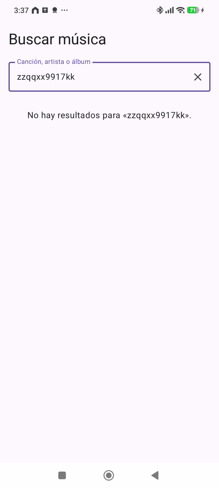 | 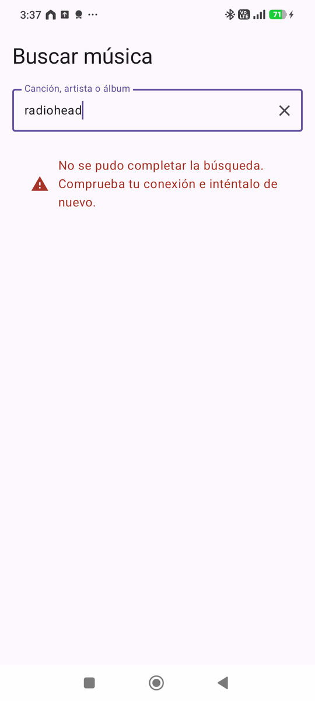 |
| **Sin resultados.** Cita el término buscado y no deja ningún resultado de una búsqueda anterior. | **Error de red** (Wi-Fi y datos desactivados). Se comunica con icono y texto, no solo con color. |

### 3. Tamaño de fuente ampliado

Con la escala de fuente del sistema al 200 % (`font_scale = 2.0`).

| Captura 6 | Captura 7 | Captura 8 |
|---|---|---|
| 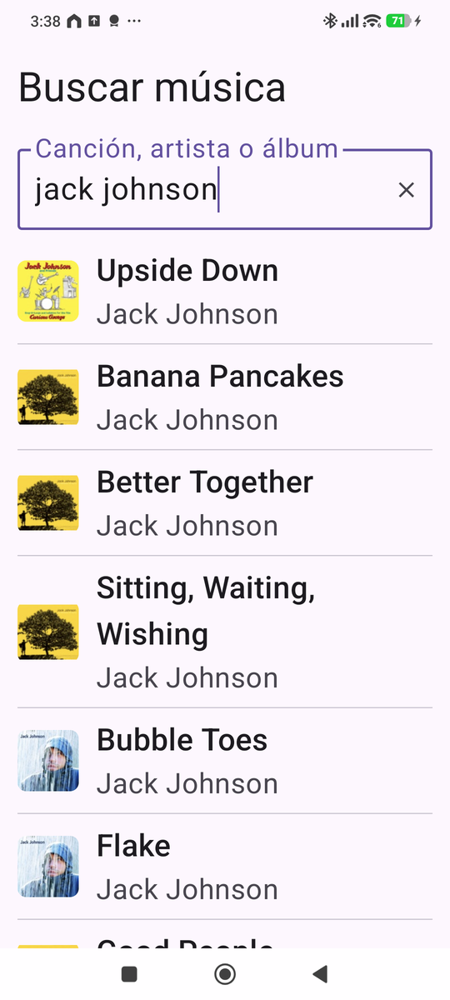 | 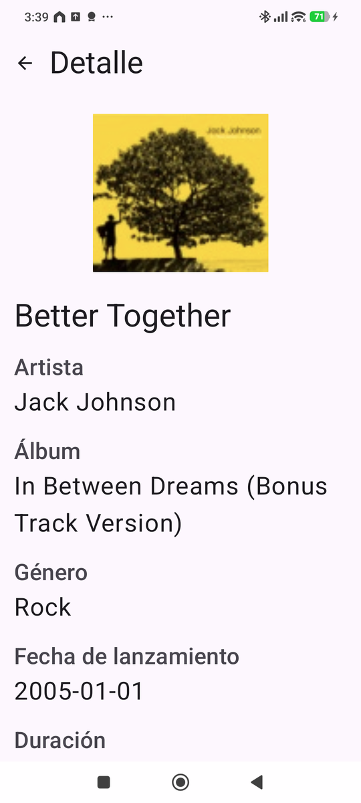 | 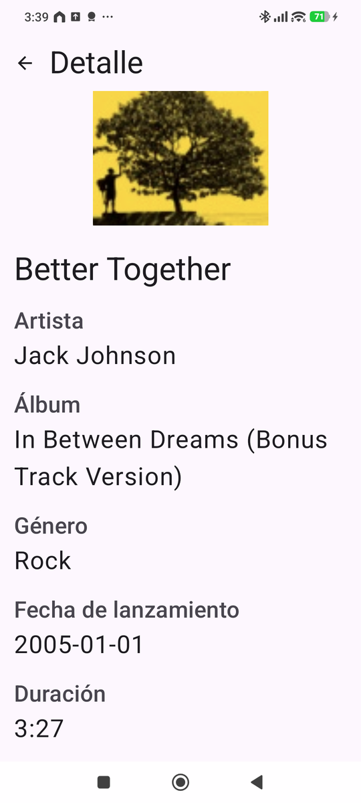 |
| **Lista.** Las filas crecen y los títulos largos pasan a dos líneas, sin cortes. | **Detalle.** El álbum largo se parte en dos líneas y el último campo queda debajo del borde. | **Detalle con scroll.** El contenido es desplazable y el último campo («Duración») se alcanza. |

### 4. Contraste y tema oscuro

| Captura 2 (claro) | Captura 9 (oscuro) | Captura 10 (oscuro) |
|---|---|---|
|  | 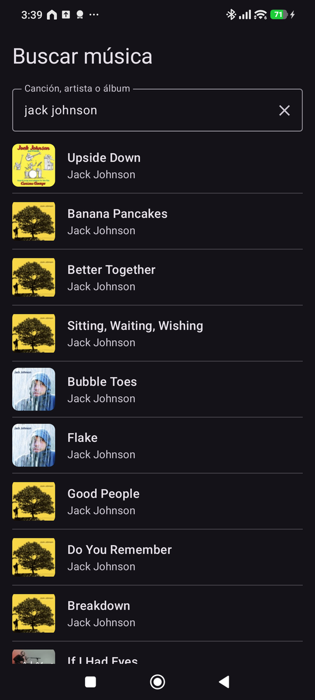 | 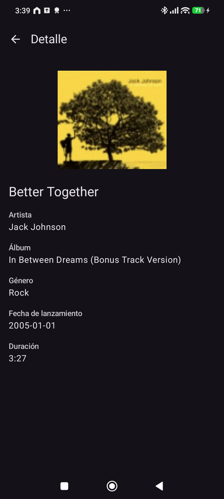 |
| **Tema claro.** | **Tema oscuro.** La app sigue el tema del sistema. | **Detalle en tema oscuro.** |

Ratios de contraste medidos sobre los píxeles de las propias capturas (fórmula WCAG; el mínimo exigido para texto es 4,5:1):

| Elemento | Tema | Texto | Fondo | Ratio |
|---|---|---|---|---|
| Título y texto principal | Claro | `#1D1B20` | `#FDF7FE` | 16,2:1 |
| Texto secundario (artista) | Claro | `#48454E` | `#FDF7FE` | 8,9:1 |
| Etiqueta del campo (con foco) | Claro | `#63519F` | `#FDF7FE` | 6,2:1 |
| Mensaje de error | Claro | `#A53328` | `#FDF7FE` | 6,4:1 |
| Título y texto principal | Oscuro | `#E5E0E8` | `#141218` | 14,3:1 |
| Texto secundario y etiqueta (sin foco) | Oscuro | `#C9C4CF` | `#141218` | 10,9:1 |

El mensaje de error en el tema oscuro no se midió.

### 5. TalkBack

Capturas con TalkBack activado: el recuadro verde es el foco de TalkBack, es decir, lo que leería en voz alta.

| Captura 11 | Captura 12 | Captura 13 |
|---|---|---|
| 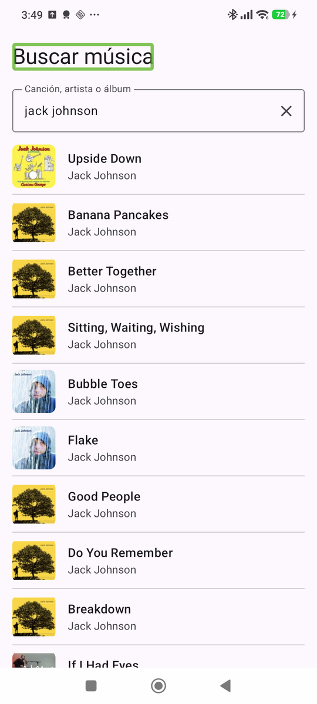 | 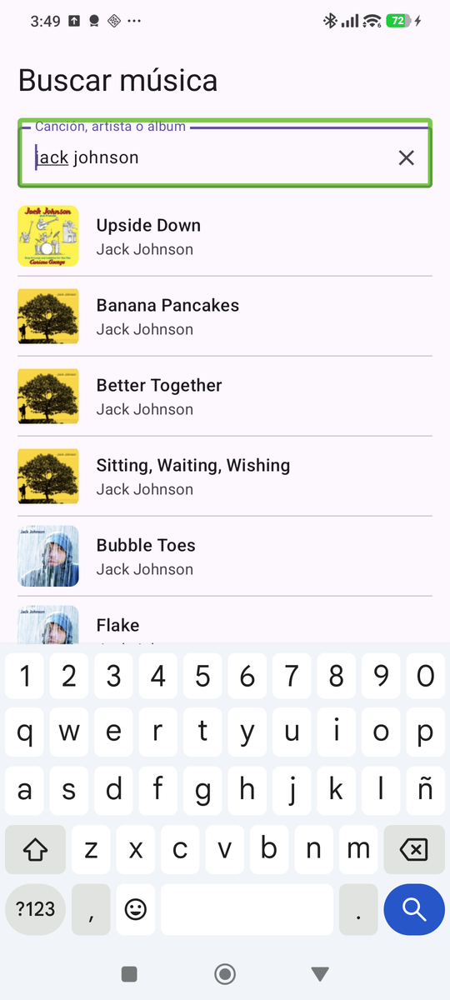 | 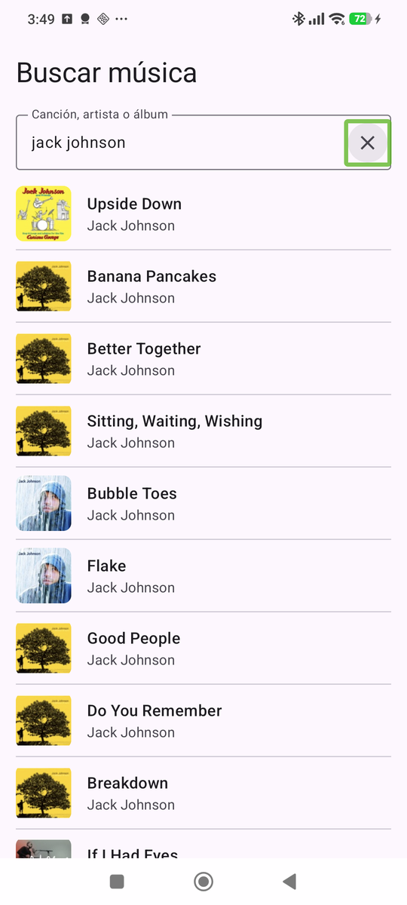 |
| **Título.** Marcado como encabezado (`heading()`). | **Campo.** El foco abarca el campo con su etiqueta visible; el teclado muestra la tecla de búsqueda. | **Botón de borrar.** Foco sobre el botón (área táctil de 48 dp) con su descripción de contenido. |

| Captura 14 | Captura 15 | Captura 16 |
|---|---|---|
| 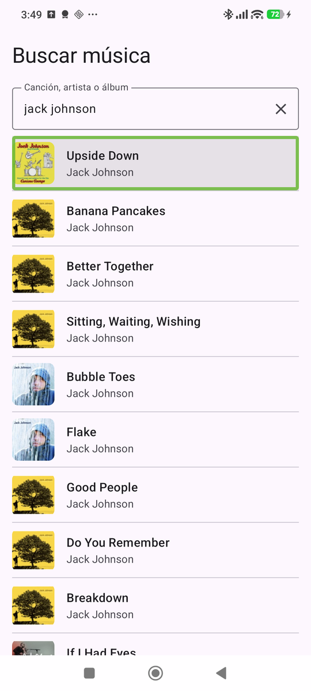 | 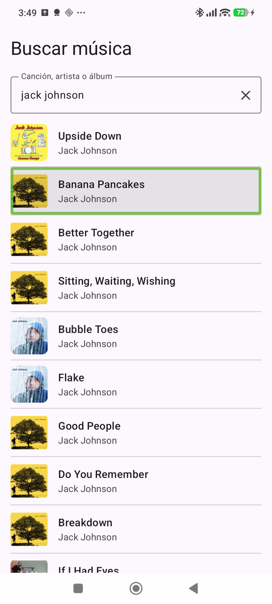 | 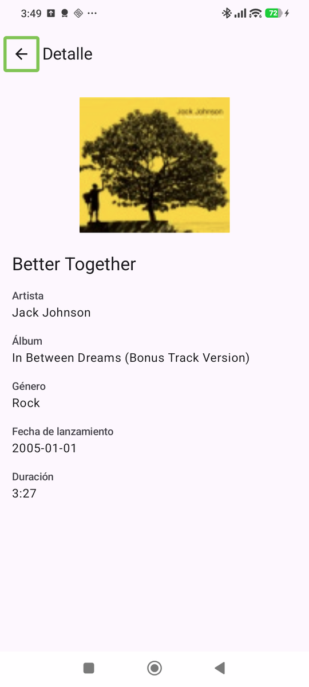 |
| **Fila agrupada.** Carátula, título y artista forman un único elemento. | **Fila siguiente.** El siguiente avance de foco salta a la fila contigua, sin paradas intermedias. | **Detalle.** Al abrirlo, el foco empieza en el botón «Volver». |

Alcance de estas pruebas:

- Las capturas muestran el **foco** de TalkBack, no su locución, que no queda reflejada en una imagen. Para moverse entre elementos se usó el teclado (`Tab`), porque los gestos simulados por `adb` activan el elemento en lugar de enfocarlo.
- **No verificado:** que TalkBack anuncie los cambios de estado (`liveRegion`) y la revisión con Accessibility Scanner, que requiere Google Play.

## Tests

- Domain: caso de uso con un repositorio fake.
- Data: la caché por separado (TTL, reinicio al reescribir, claves independientes), el repositorio (hit, miss, expiración y límite del TTL, errores no cacheados, ids duplicados) y el parseo de la respuesta con MockWebServer.
- ViewModel: debounce, estados, cancelación de búsquedas anteriores y que se pase a *Cargando* al editar el texto; y el `DetailViewModel` (cargado y no encontrado).
